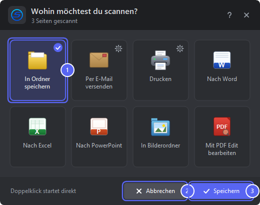
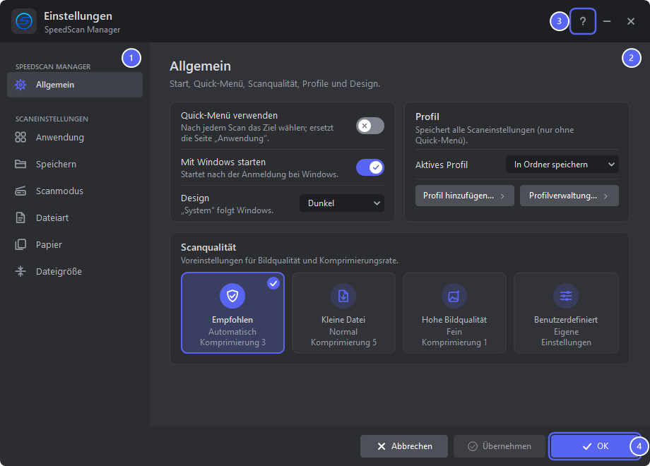
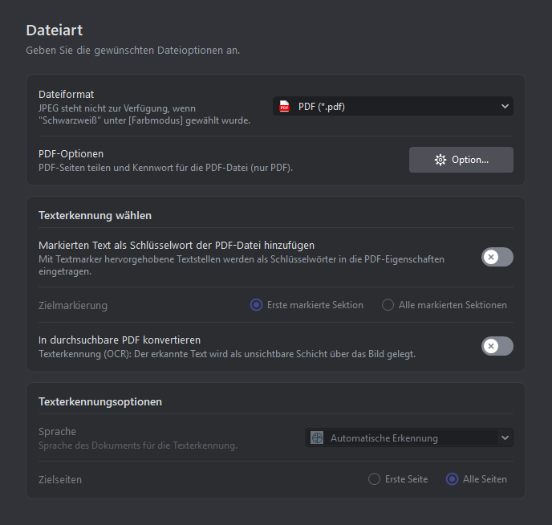
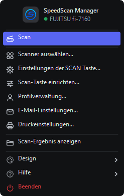

<div align="center">


# **SpeedScan Manager**

**One-button document scanning for Windows: from paper to searchable PDF, fully offline.**

<p>
  <a href="https://github.com/VeridonNetzwerk/SpeedScanManager/blob/main/LICENSE">
    
  </a>
  <a href="https://github.com/VeridonNetzwerk/SpeedScanManager/releases/latest">
    
  </a>
  <a href="https://github.com/VeridonNetzwerk/SpeedScanManager/issues">
    
  </a>
  <a href="https://github.com/VeridonNetzwerk/SpeedScanManager/stargazers">
    
  </a>
  <a href="https://github.com/VeridonNetzwerk/SpeedScanManager/actions">
    
  </a>
  <a href="https://discord.gg/CmCXZhAr59">
    
  </a>
  <br>
  
  
  
  
</p>

</div>

---

SpeedScan Manager sits in the system tray and waits for your scanner. Press the scan button on the device, and a few seconds later the pages are straightened, cleaned up, run through text recognition and saved as a searchable PDF, or sent to the e-mail program, the printer or Word. Nothing leaves your computer: no account, no cloud, no telemetry.

## ✨ Features

| Feature | Description |
|---------|-------------|
| 🖲️ **Scan button** | Starts scanning straight from the button on the scanner, no window needed |
| ⚡ **Quick menu** | After each scan, choose where it goes: folder, e-mail, printer, Word / Excel / PowerPoint, picture folder |
| 🔤 **Text recognition (OCR)** | Searchable PDFs in 15 languages, with automatic language detection per page and two quality levels (accurate / fast) |
| 📐 **Page clean-up** | Automatic rotation, deskew, cropping and removal of blank pages |
| 📄 **Output formats** | PDF (single or split by page count, optional password), JPEG and PNG |
| 🎨 **Scan settings** | Color / grayscale / black & white (or automatic), simplex / duplex, paper size detection, custom sizes, carrier sheet, multi-feed detection |
| 🏷️ **File names** | Free naming pattern with date, counter and keywords taken from marked text |
| 👤 **Profiles** | Save complete settings as profiles and switch between them in the tray menu |
| 🌐 **Multilingual** | 14 UI languages with built-in help (with screenshots) in every language |
| 🌗 **Light & dark** | Modern interface that follows the Windows theme |
| 🔄 **Updates** | Checks GitHub for new versions and installs them on request |
| 🔒 **Offline** | Scanning, OCR and processing run entirely on your PC; the internet is only used for update checks and optional OCR language downloads |

---

## 🖼️ Screenshots

<div align="center">







</div>

---

## 🛠️ Requirements

| Component | Notes |
|-----------|-------|
| OS | Windows 10 or 11 |
| Scanner | Document scanner with a TWAIN driver (developed and tested with a Fujitsu fi-6130). Reports about other models are welcome as an [issue](https://github.com/VeridonNetzwerk/SpeedScanManager/issues) |
| .NET | Not needed: releases are self-contained |
| Disk space | About 260 MB installed (more with additional OCR languages) |

---

## 🚀 Quick Start

### Option A: Installer (recommended)

1. Download `SpeedScanManager-<version>-Setup-win-x86.exe` from the [latest release](https://github.com/VeridonNetzwerk/SpeedScanManager/releases/latest)
2. Run it. Windows SmartScreen may warn because the installer is unsigned: click **More info → Run anyway**
3. Pick your language. The setup installs text recognition for that language plus English; further languages can be added later in the app with one click
4. SpeedScan Manager starts in the tray and registers itself for the scanner's scan button
5. Put paper in the scanner and press the button

Uninstall via *Settings → Apps* or the *Uninstall* shortcut in the Start menu.

### Option B: Portable

1. Download `SpeedScanManager-<version>-portable-win-x86.zip` from the [latest release](https://github.com/VeridonNetzwerk/SpeedScanManager/releases/latest)
2. Extract it anywhere and start `SpeedScanManager.exe`

> **Scan button:** registering for the scanner button writes to HKLM, so Windows asks once for administrator rights. `SpeedScanManager.exe /unregister` (or the uninstaller) removes the registration and restores the Windows default.

### Option C: Build from Source

```powershell
git clone https://github.com/VeridonNetzwerk/SpeedScanManager.git
cd SpeedScanManager
.\build-release.ps1
```

This creates the portable ZIP and the installer in `release\v<version>\`. Only the app, without installer:

```powershell
dotnet publish SpeedScanManager.csproj -c Release -r win-x86 --self-contained true -o dist
```

The app is built for x86 because most TWAIN drivers are 32-bit.

---

## 🔤 Text Recognition

| | |
|---|---|
| **Languages** | German, English, French, Italian, Spanish, Portuguese, Dutch, Polish, Turkish, Russian, Arabic, Japanese, Korean, Chinese (simplified & traditional) |
| **Automatic** | Detects the script of every page (Latin, Cyrillic, Arabic, CJK) and, for Latin pages, the language from the recognized text. If a language is detected that isn't installed yet, the app offers to download it |
| **Quality** | *Accurate* (default) or *Fast* (about twice as fast, slightly less accurate) |
| **Downloads** | Missing languages are downloaded on demand from the official Tesseract model repositories (about 10–40 MB each) |

---

## 🏗️ Architecture

```
SpeedScanManager/
├── Program.cs               # Entry point, single instance, command line (/scanbutton, /unregister)
├── Core/
│   ├── Configuration/       # Settings, profiles, file name patterns
│   ├── Interop/             # Scanner button events (WIA) and pipe to the running instance
│   ├── Localization/        # Translation lookup (lang/*.json)
│   ├── Scanning/            # TWAIN pipeline, page clean-up, OCR, PDF / image output
│   └── Updates/             # GitHub release check
├── UI/
│   ├── Forms/               # Tray application, settings window, help
│   ├── Tabs/                # The settings pages
│   ├── Dialogs/             # Quick menu, options and progress dialogs
│   └── Theming/             # Light / dark window style
├── Helpers/                 # Icons, Office / e-mail / print export, logging
├── installer/               # WPF setup with embedded app
├── lang/                    # UI and help translations
├── tessdata/                # Bundled OCR data (orientation detection, German, English)
└── .github/workflows/       # CI: builds and publishes releases
```

### Tech Stack

| Layer | Technology |
|-------|-----------|
| App | C#, .NET 8, WinForms |
| Installer | WPF, WebView2 |
| Scanner | [NTwain](https://github.com/soukoku/NTwain) (TWAIN) |
| OCR | [Tesseract](https://github.com/tesseract-ocr/tesseract) via [Tesseract .NET](https://github.com/charlesw/tesseract) |
| PDF | [PdfSharpCore](https://github.com/ststeiger/PdfSharpCore) |
| Office export | [Open XML SDK](https://github.com/dotnet/Open-XML-SDK) |
| Icons | [SVG.NET](https://github.com/svg-net/SVG) |

---

## ⚙️ Data Storage

| Path | Content |
|------|---------|
| `%APPDATA%\SpeedScanManager\settings.json` | Settings |
| `%APPDATA%\SpeedScanManager\profiles.json` | Profiles |
| `%LOCALAPPDATA%\SpeedScanManager\tessdata\` | Downloaded OCR languages |
| `%LOCALAPPDATA%\SpeedScanManager\twain_diag.log` | Diagnostic log (helpful for bug reports) |

PDF passwords are stored encrypted for the current Windows user (DPAPI).

---

## 🔨 Build & CI

Every push to `main` builds the app and the installer on `windows-latest`; the files are available as artifacts in the [Actions tab](https://github.com/VeridonNetzwerk/SpeedScanManager/actions). Pushing a `v*` tag additionally publishes them as a [GitHub release](https://github.com/VeridonNetzwerk/SpeedScanManager/releases), which the app's update check picks up.

---

## 🐛 Reporting Issues

Found a bug? Open an [**issue**](https://github.com/VeridonNetzwerk/SpeedScanManager/issues/new) and include:

- What you expected vs. what actually happened
- Scanner model and Windows version
- Whether you use the installer or the portable version
- The log file `%LOCALAPPDATA%\SpeedScanManager\twain_diag.log`, if possible

Questions and ideas are also welcome on [Discord](https://discord.gg/CmCXZhAr59).

---

## 💖 Support

If you like this project, consider donating:

<a href="https://www.paypal.com/donate/?hosted_button_id=972P9WTWE7RBU">
  
</a>

---

## 🙏 Credits & Built With

| Project | Role |
|---------|------|
| [Tesseract OCR](https://github.com/tesseract-ocr/tesseract) | Text recognition engine and language models |
| [Tesseract .NET](https://github.com/charlesw/tesseract) | .NET wrapper for Tesseract |
| [NTwain](https://github.com/soukoku/NTwain) | TWAIN scanner access |
| [PdfSharpCore](https://github.com/ststeiger/PdfSharpCore) | PDF creation |
| [Open XML SDK](https://github.com/dotnet/Open-XML-SDK) | Word, Excel and PowerPoint export |
| [SVG.NET](https://github.com/svg-net/SVG) | Icon rendering |
| [WebView2](https://developer.microsoft.com/microsoft-edge/webview2/) | Installer pages |

### 🤖 Built With AI

Parts of this project were created and refined with the assistance of AI tools.

---

<div align="center">
  <sub>© 2026 VeridonNetzwerk · GPL-3.0 License</sub>
</div>
